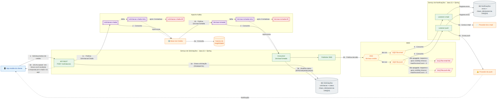
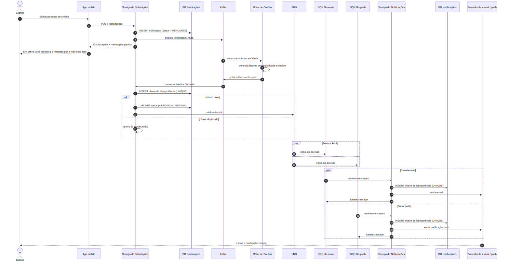
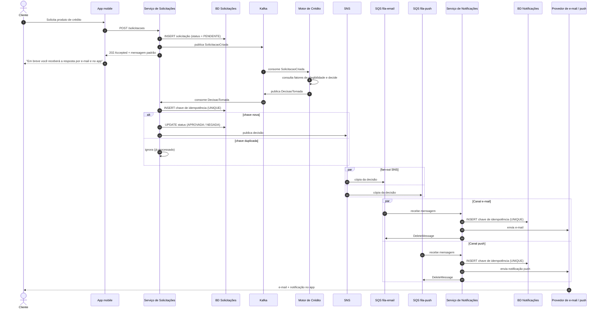
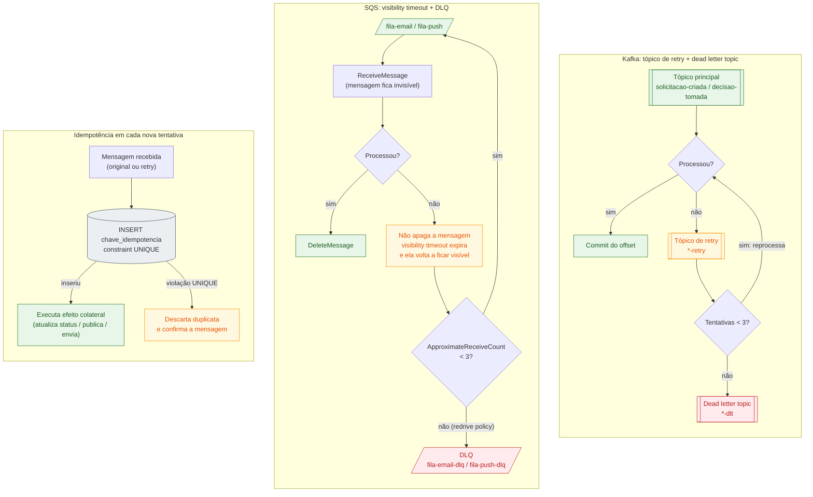

# Fluxo de Crédito

Solicitação **assíncrona** de um produto de crédito, mesmo quando o cliente não o tem no catálogo. A resposta chega por **e-mail** e por **notificação no app**.

## Componentes

| Componente | Responsabilidade |
|---|---|
| **App mobile** | Envia a solicitação e recebe a notificação push. |
| **Serviço de Solicitações** (Java 21 + Spring) | Grava a solicitação, publica `SolicitacaoCriada` no Kafka, responde com uma mensagem padrão, consome `DecisaoTomada`, atualiza o status e publica a decisão no SNS. |
| **Motor de Crédito** | Consome `SolicitacaoCriada`, consulta os fatores de elegibilidade, decide e publica `DecisaoTomada`. |
| **SNS → SQS** | Fan-out da decisão para as filas `fila-email` e `fila-push`. |
| **Serviço de Notificações** (Java 21 + Spring) | Consome as filas SQS e envia o e-mail e a notificação push. |

## 1. Visão geral da arquitetura

```mermaid
flowchart LR
    classDef app fill:#E3F2FD,stroke:#1565C0,color:#0D47A1
    classDef svc fill:#E8F5E9,stroke:#2E7D32,color:#1B5E20
    classDef ext fill:#FFF3E0,stroke:#EF6C00,color:#E65100
    classDef kafka fill:#F3E5F5,stroke:#6A1B9A,color:#4A148C
    classDef aws fill:#FFF8E1,stroke:#FF8F00,color:#E65100
    classDef db fill:#ECEFF1,stroke:#455A64,color:#263238
    classDef dlq fill:#FFEBEE,stroke:#C62828,color:#B71C1C

    APP["📱 App mobile do cliente"]:::app

    subgraph SOL["Serviço de Solicitações · Java 21 + Spring"]
        direction TB
        API["API REST<br/>POST /solicitacoes"]:::svc
        CONS_DEC["Consumer<br/>DecisaoTomada"]:::svc
        PUB_SNS["Publisher SNS"]:::svc
    end
    DB_SOL[("BD Solicitações<br/>solicitacao + status<br/>chave_idempotencia UNIQUE")]:::db

    subgraph KAFKA["Apache Kafka"]
        direction TB
        T_SOL[["solicitacao-criada"]]:::kafka
        T_SOL_RETRY[["solicitacao-criada-retry"]]:::kafka
        T_SOL_DLT[["solicitacao-criada-dlt"]]:::dlq
        T_DEC[["decisao-tomada"]]:::kafka
        T_DEC_RETRY[["decisao-tomada-retry"]]:::kafka
        T_DEC_DLT[["decisao-tomada-dlt"]]:::dlq
    end

    MOTOR["⚙️ Motor de Crédito"]:::ext
    ELEG[("Fatores de<br/>elegibilidade")]:::ext

    subgraph AWS["AWS"]
        direction TB
        SNS{{"SNS<br/>decisao-credito"}}:::aws
        SQS_EMAIL[/"SQS fila-email"/]:::aws
        SQS_PUSH[/"SQS fila-push"/]:::aws
        DLQ_EMAIL[/"DLQ fila-email-dlq"/]:::dlq
        DLQ_PUSH[/"DLQ fila-push-dlq"/]:::dlq
    end

    subgraph NOT["Serviço de Notificações · Java 21 + Spring"]
        direction TB
        L_EMAIL["Listener e-mail"]:::svc
        L_PUSH["Listener push"]:::svc
    end
    DB_NOT[("BD Notificações<br/>envio + chave_idempotencia UNIQUE")]:::db

    EMAIL["✉️ Provedor de e-mail"]:::ext
    PUSH["🔔 Provedor de push"]:::ext

    %% Caminho feliz
    APP -- "1 · Solicita produto de crédito" --> API
    API -- "1a · Grava solicitação (PENDENTE)" --> DB_SOL
    API -. "1b · 202 Accepted: 'em breve você receberá<br/>a resposta por e-mail e no app'" .-> APP
    API -- "1c · Publica SolicitacaoCriada" --> T_SOL

    T_SOL -- "2 · Consome" --> MOTOR
    MOTOR -- "2a · Consulta" --> ELEG
    MOTOR -- "2b · Publica DecisaoTomada" --> T_DEC

    T_DEC -- "3 · Consome" --> CONS_DEC
    CONS_DEC -- "3a · Atualiza status<br/>(APROVADA/NEGADA)" --> DB_SOL
    CONS_DEC --> PUB_SNS
    PUB_SNS -- "3b · Publica decisão" --> SNS
    SNS -- "fan-out" --> SQS_EMAIL
    SNS -- "fan-out" --> SQS_PUSH

    SQS_EMAIL -- "4 · Consome" --> L_EMAIL
    SQS_PUSH -- "4 · Consome" --> L_PUSH
    L_EMAIL -- "Registra envio" --> DB_NOT
    L_PUSH -- "Registra envio" --> DB_NOT
    L_EMAIL -- "4a · Envia e-mail" --> EMAIL
    L_PUSH -- "4b · Envia push" --> PUSH
    PUSH -. "Notificação" .-> APP

    %% Falhas Kafka
    T_SOL -. "falha" .-> T_SOL_RETRY
    T_SOL_RETRY -. "reprocessa" .-> MOTOR
    T_SOL_RETRY -. "após 3 tentativas" .-> T_SOL_DLT
    T_DEC -. "falha" .-> T_DEC_RETRY
    T_DEC_RETRY -. "reprocessa" .-> CONS_DEC
    T_DEC_RETRY -. "após 3 tentativas" .-> T_DEC_DLT

    %% Falhas SQS
    SQS_EMAIL -. "não apagada: reaparece após visibility timeout;<br/>maxReceiveCount = 3" .-> DLQ_EMAIL
    SQS_PUSH -. "não apagada: reaparece após visibility timeout;<br/>maxReceiveCount = 3" .-> DLQ_PUSH
```



<details><summary>Fonte Mermaid</summary>


</details>

## 2. Sequência (caminho feliz + idempotência)



<details><summary>Fonte Mermaid</summary>


</details>

## 3. Tratamento de falhas e idempotência

- **Kafka:** se o processamento falhar, a mensagem vai para o tópico `*-retry`. Depois de 3 tentativas, vai para o dead letter topic `*-dlt`.
- **SQS:** a mensagem não é apagada e volta a ficar visível quando o *visibility timeout* expira. Depois de 3 recebimentos (`maxReceiveCount = 3`), vai para a DLQ.
- **Idempotência:** a cada tentativa, o serviço insere uma chave de idempotência em uma coluna com constraint `UNIQUE`. Se houver violação, a mensagem é tratada como duplicata e descartada.


<details><summary>Fonte Mermaid</summary>


</details>

## Arquivos

- `docs/*.mmd`: fontes Mermaid
- `docs/*.svg` / `docs/*.png`: imagens renderizadas

Para regenerar as imagens:

```bash
npx @mermaid-js/mermaid-cli -i docs/arquitetura.mmd -o docs/arquitetura.svg -b white
```
