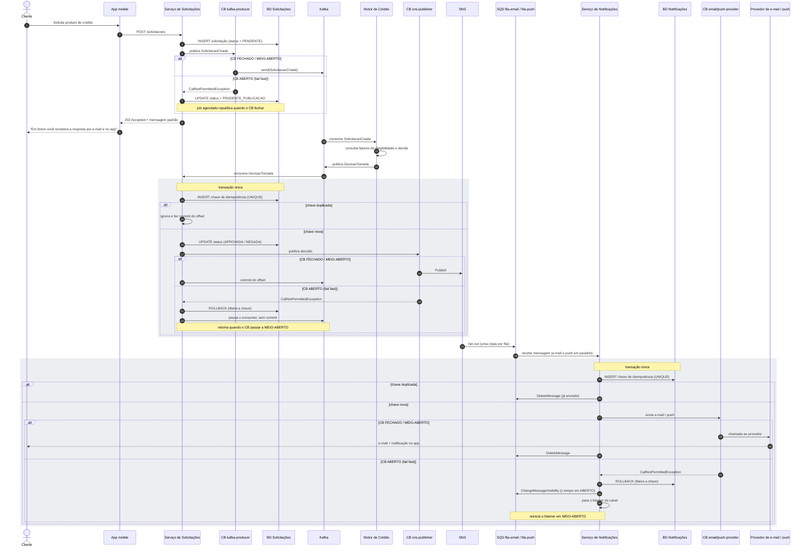
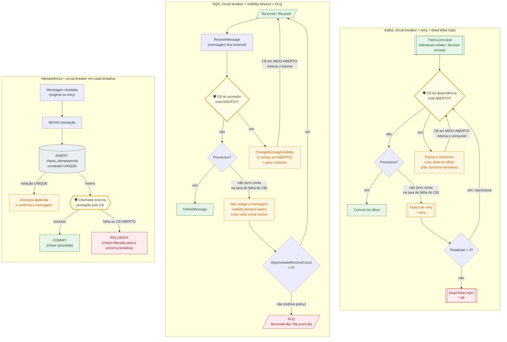
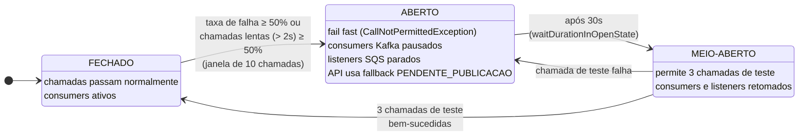

# Fluxo de Crédito

Solicitação **assíncrona** de um produto de crédito, mesmo quando o cliente não o tem no catálogo. A resposta chega por **e-mail** e por **notificação no app**.

Resiliência: **chaves de idempotência** (constraint `UNIQUE`), **retry/DLT** no Kafka, **visibility timeout/DLQ** no SQS e **circuit breakers** (Resilience4j) nas chamadas externas.

## Componentes

| Componente | Responsabilidade |
|---|---|
| **App mobile** | Envia a solicitação e recebe a notificação push. |
| **Serviço de Solicitações** (Java 21 + Spring) | Grava a solicitação, publica `SolicitacaoCriada` no Kafka, responde com uma mensagem padrão, consome `DecisaoTomada`, atualiza o status e publica a decisão no SNS. |
| **Motor de Crédito** | Consome `SolicitacaoCriada`, consulta os fatores de elegibilidade, decide e publica `DecisaoTomada`. |
| **SNS → SQS** | Fan-out da decisão para as filas `fila-email` e `fila-push`. |
| **Serviço de Notificações** (Java 21 + Spring) | Consome as filas SQS e envia o e-mail e a notificação push. |

## Circuit breakers

| Circuit breaker | Serviço | Protege | Quando está ABERTO |
|---|---|---|---|
| `kafka-producer` | Solicitações | Publicação de `SolicitacaoCriada` | Fallback: grava `PENDENTE_PUBLICACAO` e responde `202` mesmo assim; um job agendado republica quando o CB fechar. |
| `sns-publisher` | Solicitações | Publicação da decisão no SNS | Rollback da transação, pausa do consumer Kafka sem commit do offset; retoma em MEIO-ABERTO. |
| `email-provider` | Notificações | Provedor de e-mail | Rollback, `ChangeMessageVisibility` (≥ tempo em ABERTO) e parada do listener `fila-email`; reinicia em MEIO-ABERTO. |
| `push-provider` | Notificações | Provedor de push | Mesmo comportamento, no listener `fila-push`. Cada canal falha de forma independente. |

**Como os mecanismos se combinam:**

- **CB + retry/DLQ:** com o CB aberto, o consumer é pausado em vez de gastar as 3 tentativas. Assim, uma indisponibilidade prolongada da dependência não leva mensagens válidas para a DLT/DLQ. Erros reais continuam contando na taxa de falha do CB e seguem o fluxo normal de retry.
- **CB + idempotência:** a inserção da chave e a chamada externa ficam na mesma transação. Se a chamada falhar ou o CB estiver aberto, o rollback libera a chave, e a próxima tentativa não é descartada como duplicata.
- **Visibility timeout:** deve ser maior ou igual a `waitDurationInOpenState`, para a mensagem não reaparecer enquanto o CB ainda está aberto.

Configuração (Resilience4j; a versão efetiva está em `*/src/main/resources/application.yml`):

```yaml
resilience4j.circuitbreaker:
  configs:
    default:
      slidingWindowType: COUNT_BASED
      slidingWindowSize: 10
      failureRateThreshold: 50
      slowCallDurationThreshold: 2s
      slowCallRateThreshold: 50
      waitDurationInOpenState: 30s
      permittedNumberOfCallsInHalfOpenState: 3
      automaticTransitionFromOpenToHalfOpenEnabled: true
  instances:
    kafka-producer: { baseConfig: default }
    sns-publisher:  { baseConfig: default }
    email-provider: { baseConfig: default }
    push-provider:  { baseConfig: default }
```

## Código e execução

### Módulos

| Módulo | Porta | Conteúdo |
|---|---|---|
| `solicitacao-service` | 8080 | API REST (`POST/GET /api/v1/solicitacoes`), JPA + Flyway (Oracle), producer `SolicitacaoCriada`, consumer `DecisaoTomada` (`@RetryableTopic`: `-retry` → `-dlt`), publicação SNS, idempotência e CBs `kafka-producer`/`sns-publisher`. |
| `notificacao-service` | 8081 | Listeners SQS `fila-email`/`fila-push`, envio SMTP e push (REST), idempotência por canal e CBs `email-provider`/`push-provider`. |
| `motor-credito-simulador` | 8082 | Simula o motor de crédito, que é um sistema externo à solução. |

**Regras do simulador:** `clienteId` iniciado por `restrito` → NEGADA ("Restrição cadastral"). Para os demais clientes, o score e o limite são derivados do `clienteId` de forma determinística: score < 500 → NEGADA; valor acima do limite → NEGADA; caso contrário, APROVADA.

**Versões:** Java 21, Spring Boot 4.1.2 (Spring Framework 7, Spring Kafka 4.1, Hibernate 7.4, Jackson 3), Spring Cloud AWS 4.2.1 (AWS SDK v2), Resilience4j 2.4.0, Flyway 12, Oracle JDBC 23 (`ojdbc17`), Oracle Database 23ai Free, Apache Kafka 4.x (KRaft), LocalStack 4.14 (SNS/SQS), Mailpit (SMTP) e WireMock (provedor de push).

### Executar com Docker

Pré-requisitos: Linux com Docker Engine e Docker Compose v2, cerca de **6 GB de RAM** e **8 GB de disco livres**. Os datafiles do Oracle ocupam cerca de 3,2 GB.

```bash
docker compose up -d --build        # compila, roda os testes unitários e sobe tudo
docker compose ps                   # aguarde todos ficarem "healthy" (o Oracle leva 1–2 min na 1ª vez)
```

Para pular os testes no build: `SKIP_TESTS=true docker compose up -d --build`.
Se a sua rede usa proxy com inspeção TLS, copie os certificados da CA (`*.crt`) para `docker/certs/` antes do build.

| Endereço | O que é |
|---|---|
| http://localhost:8080/api/v1/solicitacoes | API de solicitações |
| http://localhost:8025 | Mailpit: e-mails enviados |
| http://localhost:8089/__admin/requests | WireMock: notificações push recebidas |
| http://localhost:8080/actuator/circuitbreakers (e 8081) | Estado dos circuit breakers |
| `localhost:1521/FREEPDB1` | Oracle (usuários `solicitacao`/`solicitacao` e `notificacao`/`notificacao`) |
| `localhost:29092` | Kafka |
| `localhost:4566` | LocalStack (SNS/SQS) |

```bash
# 1. Solicitar (retorna 202 + mensagem padrão)
curl -i -X POST localhost:8080/api/v1/solicitacoes -H 'Content-Type: application/json' -d '{
  "clienteId": "cliente-123", "produtoCodigo": "CARTAO-GOLD", "valorSolicitado": 1000.00,
  "email": "maria@exemplo.com", "tokenDispositivo": "token-maria"}'

# 2. Consultar o status (PENDENTE → APROVADA/NEGADA)
curl localhost:8080/api/v1/solicitacoes/<solicitacaoId>

# 3. Ver a resposta ao cliente: e-mail em http://localhost:8025 e push no WireMock
curl localhost:8089/__admin/requests
```

**Simular falhas:**

```bash
# DLQ: com o provedor de push fora, a mensagem volta após o visibility timeout (30 s)
# e, no 3º recebimento, vai para fila-push-dlq. O e-mail é enviado normalmente.
docker compose stop push-provider
#   ...faça uma solicitação e aguarde cerca de 90 s...
docker compose exec localstack awslocal sqs get-queue-attributes \
  --queue-url http://localhost:4566/000000000000/fila-push-dlq --attribute-names ApproximateNumberOfMessages

# Idempotência: republicar a mesma decisão no SNS não reenvia o e-mail ("mensagem duplicada ignorada")
docker compose start push-provider
docker compose exec localstack awslocal sns publish \
  --topic-arn arn:aws:sns:us-east-1:000000000000:decisao-credito --message '<corpo da mensagem da DLQ>'
docker compose logs notificacao-service | grep duplicada

# Circuit breaker: com 5+ chamadas e 50% de falhas, o CB abre e o listener é parado
curl localhost:8081/actuator/circuitbreakers
```

Para parar: `docker compose down` (ou `docker compose down -v` para apagar também o banco).

### Testes unitários

```bash
mvn test                       # requer JDK 21+ e Maven 3.9+
# ou, sem Maven local:
docker run --rm -v "$PWD":/ws -w /ws maven:3.10-eclipse-temurin-21 mvn -B test
```

### Observações

- **LocalStack 4.14:** as versões mais novas exigem `LOCALSTACK_AUTH_TOKEN`; a 4.14 é a última que roda sem conta.
- **Contagem de recebimentos no SQS:** cada recebimento incrementa `ApproximateReceiveCount`, mesmo com o CB aberto. Para não gastar as 3 tentativas durante uma indisponibilidade, o listener é parado quando o CB abre e a visibilidade da mensagem em processamento é estendida para 30 s (≥ `waitDurationInOpenState`). Ainda assim, uma indisponibilidade muito longa com reaberturas sucessivas do CB pode levar mensagens à DLQ. Por isso as DLQs devem ser monitoradas e reprocessadas (redrive).
- **Tópicos Kafka:** criados com 3 partições por quem subir primeiro, seja o `@RetryableTopic` ou um `NewTopic`. A chave da mensagem é o `solicitacaoId`, o que garante a ordem por solicitação.

## 1. Visão geral da arquitetura

```mermaid
flowchart LR
    classDef app fill:#E3F2FD,stroke:#1565C0,color:#0D47A1
    classDef svc fill:#E8F5E9,stroke:#2E7D32,color:#1B5E20
    classDef ext fill:#FFF3E0,stroke:#EF6C00,color:#E65100
    classDef kafka fill:#F3E5F5,stroke:#6A1B9A,color:#4A148C
    classDef aws fill:#FFF8E1,stroke:#FF8F00,color:#E65100
    classDef db fill:#ECEFF1,stroke:#455A64,color:#263238
    classDef dlq fill:#FFEBEE,stroke:#C62828,color:#B71C1C
    classDef cb fill:#FFFDE7,stroke:#F9A825,stroke-width:3px,color:#5D4037
    classDef fb fill:#FCE4EC,stroke:#AD1457,stroke-dasharray:4 3,color:#880E4F

    APP["📱 App mobile do cliente"]:::app

    subgraph SOL["Serviço de Solicitações · Java 21 + Spring"]
        direction TB
        API["API REST<br/>POST /solicitacoes"]:::svc
        CB_KAFKA{{"🛡️ CB kafka-producer"}}:::cb
        FB_KAFKA["Fallback:<br/>status PENDENTE_PUBLICACAO<br/>+ job de republicação"]:::fb
        CONS_DEC["Consumer<br/>DecisaoTomada"]:::svc
        CB_SNS{{"🛡️ CB sns-publisher"}}:::cb
        FB_SNS["CB aberto:<br/>pausa o consumer Kafka<br/>(sem commit do offset)"]:::fb
    end
    DB_SOL[("BD Solicitações<br/>solicitacao + status<br/>chave_idempotencia UNIQUE")]:::db

    subgraph KAFKA["Apache Kafka"]
        direction TB
        T_SOL[["solicitacao-criada"]]:::kafka
        T_SOL_RETRY[["solicitacao-criada-retry"]]:::kafka
        T_SOL_DLT[["solicitacao-criada-dlt"]]:::dlq
        T_DEC[["decisao-tomada"]]:::kafka
        T_DEC_RETRY[["decisao-tomada-retry"]]:::kafka
        T_DEC_DLT[["decisao-tomada-dlt"]]:::dlq
    end

    MOTOR["⚙️ Motor de Crédito"]:::ext
    ELEG[("Fatores de<br/>elegibilidade")]:::ext

    subgraph AWS["AWS"]
        direction TB
        SNS{{"SNS<br/>decisao-credito"}}:::aws
        SQS_EMAIL[/"SQS fila-email"/]:::aws
        SQS_PUSH[/"SQS fila-push"/]:::aws
        DLQ_EMAIL[/"DLQ fila-email-dlq"/]:::dlq
        DLQ_PUSH[/"DLQ fila-push-dlq"/]:::dlq
    end

    subgraph NOT["Serviço de Notificações · Java 21 + Spring"]
        direction TB
        L_EMAIL["Listener e-mail"]:::svc
        CB_EMAIL{{"🛡️ CB email-provider"}}:::cb
        L_PUSH["Listener push"]:::svc
        CB_PUSH{{"🛡️ CB push-provider"}}:::cb
        FB_NOT["CB aberto:<br/>para o listener do canal<br/>+ ChangeMessageVisibility"]:::fb
    end
    DB_NOT[("BD Notificações<br/>envio + chave_idempotencia UNIQUE")]:::db

    EMAIL["✉️ Provedor de e-mail"]:::ext
    PUSH["🔔 Provedor de push"]:::ext

    %% Caminho feliz
    APP -- "1 · Solicita produto de crédito" --> API
    API -- "1a · Grava solicitação (PENDENTE)" --> DB_SOL
    API -. "1b · 202 Accepted: 'em breve você receberá<br/>a resposta por e-mail e no app'" .-> APP
    API --> CB_KAFKA
    CB_KAFKA -- "1c · FECHADO: publica SolicitacaoCriada" --> T_SOL
    CB_KAFKA -. "ABERTO" .-> FB_KAFKA
    FB_KAFKA -. "republica quando o CB fechar" .-> T_SOL

    T_SOL -- "2 · Consome" --> MOTOR
    MOTOR -- "2a · Consulta" --> ELEG
    MOTOR -- "2b · Publica DecisaoTomada" --> T_DEC

    T_DEC -- "3 · Consome" --> CONS_DEC
    CONS_DEC -- "3a · Chave de idempotência + status<br/>(APROVADA/NEGADA), mesma transação" --> DB_SOL
    CONS_DEC --> CB_SNS
    CB_SNS -- "3b · FECHADO: publica decisão" --> SNS
    CB_SNS -. "ABERTO" .-> FB_SNS
    FB_SNS -. "retoma em MEIO-ABERTO" .-> CONS_DEC
    SNS -- "fan-out" --> SQS_EMAIL
    SNS -- "fan-out" --> SQS_PUSH

    SQS_EMAIL -- "4 · Consome" --> L_EMAIL
    SQS_PUSH -- "4 · Consome" --> L_PUSH
    L_EMAIL -- "Chave de idempotência" --> DB_NOT
    L_PUSH -- "Chave de idempotência" --> DB_NOT
    L_EMAIL --> CB_EMAIL
    L_PUSH --> CB_PUSH
    CB_EMAIL -- "4a · FECHADO: envia e-mail" --> EMAIL
    CB_PUSH -- "4b · FECHADO: envia push" --> PUSH
    CB_EMAIL -. "ABERTO" .-> FB_NOT
    CB_PUSH -. "ABERTO" .-> FB_NOT
    PUSH -. "Notificação" .-> APP

    %% Falhas Kafka
    T_SOL -. "falha" .-> T_SOL_RETRY
    T_SOL_RETRY -. "reprocessa" .-> MOTOR
    T_SOL_RETRY -. "após 3 tentativas" .-> T_SOL_DLT
    T_DEC -. "falha" .-> T_DEC_RETRY
    T_DEC_RETRY -. "reprocessa" .-> CONS_DEC
    T_DEC_RETRY -. "após 3 tentativas" .-> T_DEC_DLT

    %% Falhas SQS
    SQS_EMAIL -. "não apagada: reaparece após visibility timeout;<br/>maxReceiveCount = 3" .-> DLQ_EMAIL
    SQS_PUSH -. "não apagada: reaparece após visibility timeout;<br/>maxReceiveCount = 3" .-> DLQ_PUSH
```


<details><summary>Fonte Mermaid</summary>


</details>

## 2. Sequência (idempotência + circuit breaker)


<details><summary>Fonte Mermaid</summary>


</details>

## 3. Tratamento de falhas


<details><summary>Fonte Mermaid</summary>


</details>

## 4. Estados do circuit breaker


<details><summary>Fonte Mermaid</summary>


</details>

## Arquivos

- `solicitacao-service/`, `notificacao-service/`, `motor-credito-simulador/`: código e testes
- `Dockerfile`: build multi-stage (Maven → JRE 21), um target por serviço
- `docker-compose.yml`: solução completa (Oracle, Kafka, LocalStack, Mailpit, WireMock e os 3 serviços)
- `docker/`: init do Oracle (usuários), do LocalStack (tópico, filas, DLQs e assinaturas) e stub do WireMock
- `docs/*.mmd`: fontes Mermaid
- `docs/*.svg` / `docs/*.png`: imagens renderizadas

Para regenerar as imagens:

```bash
npx @mermaid-js/mermaid-cli -i docs/arquitetura.mmd -o docs/arquitetura.svg -b white
```
